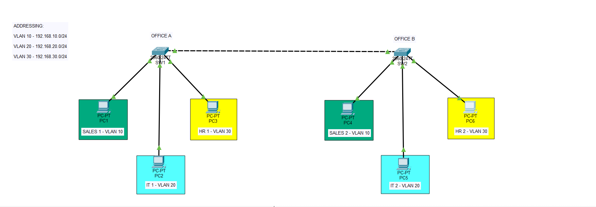

# Enterprise VLAN Network Segmentation

## Project Overview

This project simulates a small enterprise network
consisting of three departments: Sales, HR, and IT.

VLANs are implemented to logically segment the
network, reduce broadcast traffic, and establish
a foundation for future network security policies.

## Business Requirements

- Separate departments into individual VLANs.
- Allow same-VLAN communication across switches.
- Prevent direct Layer 2 communication between
  different departments.
- Establish trunk connectivity between switches.
- Provide a scalable network infrastructure.

## Network Topology

## Technologies Used

- Cisco Packet Tracer
- Cisco Catalyst 2960
- Virtual Local Area Networks (VLANs)
- IEEE 802.1Q Trunking
- IPv4 Addressing
- Layer 2 Switching

## VLAN Assignment

| VLAN | Department | Network |
|------|------------|---------|
| 10 | Sales | 192.168.10.0/24 |
| 20 | HR | 192.168.20.0/24 |
| 30 | IT | 192.168.30.0/24 |

## Device Configurations

- [SW1 Configuration](Configurations/OFFICE_A_SW.txt)
- [SW2 Configuration](Configurations/OFFICE_B_SW.txt)

## Verification and Testing

Testing results will be documented upon completion
of the laboratory.

## Skills Demonstrated

- Network segmentation
- VLAN configuration
- Access port configuration
- Trunk port configuration
- IPv4 addressing
- Network connectivity verification

## Project File

[Packet Tracer Lab](Branch_Office_VLAN.pkt)

## Learning References

- Cisco Networking Academy
- Cisco CCNA 200-301 study materials

## Author

Vans Mcklyed S. Gonzales

