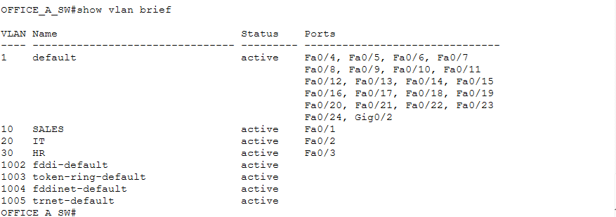
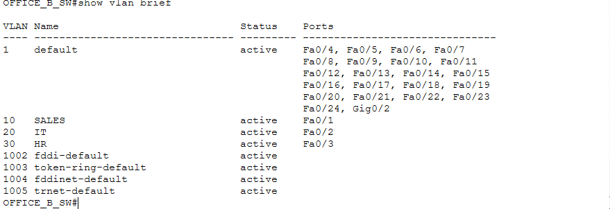
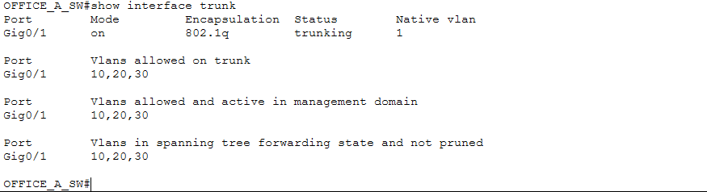
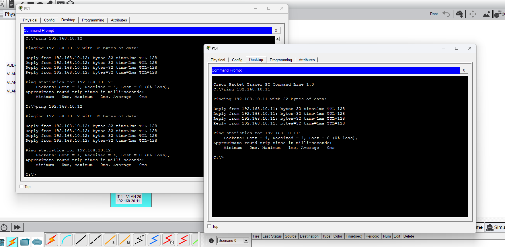
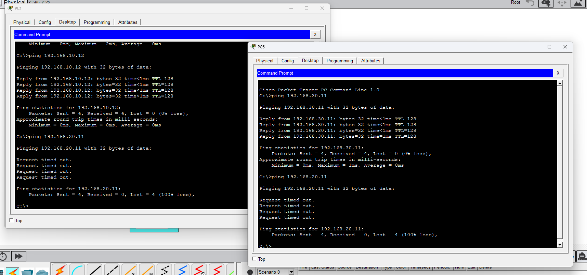

# Network Verification

This folder contains the verification commands and
connectivity tests for the VLAN configuration lab.

The purpose of these tests is to check whether the VLANs,
access ports, and trunk links are configured correctly.

## Verification Commands

| Command | Purpose |
|---------|---------|
| show vlan brief | Verify VLANs and port assignments |
| show interfaces trunk | Verify trunk status and allowed VLANs |
| show interfaces status | Check switch port status |
| show mac address-table | Check learned MAC addresses |

## VLAN Verification

## Trunk Verification

## Connectivity Testing

| Source | Destination | Expected Result | Actual Result |
|--------|-------------|-----------------|---------------|
| SALES-1 | SALES-2 | Successful | Successful |
| IT-1 | IT-2 | Successful | Successful |
| HR-1 | HR-2 | Successful | Successful |
| SALES-1 | IT-1 | Failed | Failed |
| HR-1 | SALES-2 | Failed | Failed |

## Same-VLAN Connectivity

## Inter-VLAN Isolation

Devices belonging to different VLANs are not expected
to communicate because inter-VLAN routing is not
configured in this lab.

[Back to Lab Overview](../README.md)
