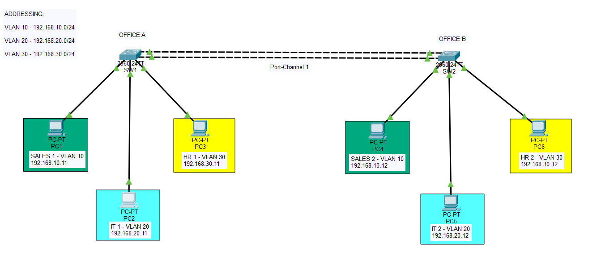

# Lab 02 - EtherChannel Configuration

## Overview

This lab is a continuation of my previous VLAN
configuration lab. The main purpose is to improve
the connection between two switches by combining
multiple physical links into a single logical link
using EtherChannel.

## Business Scenario

As the company grows, network traffic between
the two offices is expected to increase. Having
only one connection between the switches also
creates a single point of failure.

EtherChannel using LACP is implemented in this
lab to provide additional bandwidth and link
redundancy.

## Network Topology

## EtherChannel Configuration

| Parameter | Configuration |
|---|---|
| Protocol | LACP |
| SW1 Mode | Active |
| SW2 Mode | Passive |
| Member Interfaces | G0/1 and G0/2 |
| Port-Channel | Po1 |
| Switchport Mode | Trunk |
| Allowed VLANs | 10, 20, 30 |

## Lab Objectives

- Configure EtherChannel using LACP.
- Combine two physical links into one logical link.
- Configure the Port-Channel as a trunk.
- Maintain connectivity between the same VLANs.
- Test network connectivity during a link failure.

## Technologies Used

- Cisco Packet Tracer
- Cisco Catalyst 2960
- EtherChannel
- LACP
- IEEE 802.1Q Trunking
- VLANs

## Lab Documentation

- [Switch Configurations](./Configurations/)
- [Network Verification](./Verifications/)
- [Troubleshooting](./Troubleshooting/)
- [Packet Tracer File](./EtherChannel.pkt)

## Project Status

In Progress

[Previous Lab - VLAN Configuration](../01-VLAN-Configuration/)
