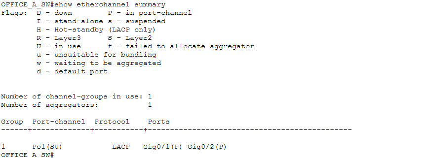
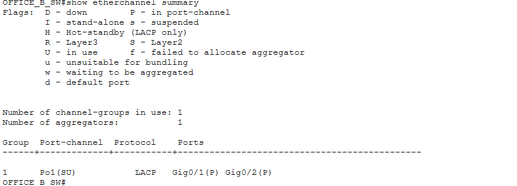
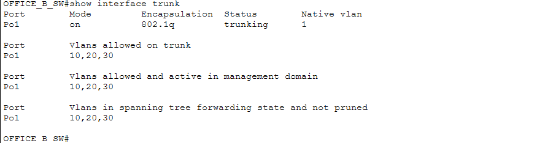
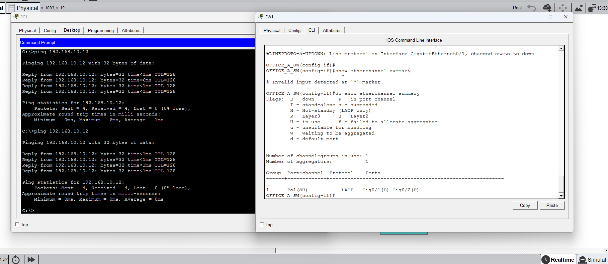
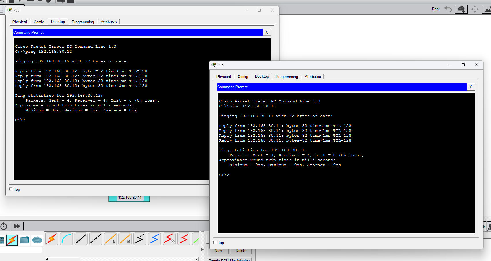

# Network Verification

This section contains the verification results
for the EtherChannel lab. The tests are performed
to check whether both physical links are properly
bundled and whether connectivity is maintained
when one link fails.

## Verification Commands

| Command | Purpose |
|---|---|
| show etherchannel summary | Check EtherChannel status |
| show interfaces trunk | Verify trunk configuration |
| show lacp neighbor | Verify LACP neighbor |
| show interfaces port-channel 1 | Check logical interface |
| show spanning-tree | Verify STP status |

## EtherChannel Status

## Trunk Status

## Connectivity and Redundancy Testing

| Test | Expected Result | Actual Result |
|---|---|---|
| Both links active | EtherChannel operational | EtherChannel Operational |
| Same-VLAN ping | Successful | Successful |
| One member link disabled | Port-Channel remains up | Port-Channel remains up |
| Ping during link failure | Connectivity maintained | Connectivity maintained |
| Failed link restored | Both links bundled | Both links bundled |

## Link Failure Simulation

## Connectivity Test

[Back to Lab Overview](../README.md)
