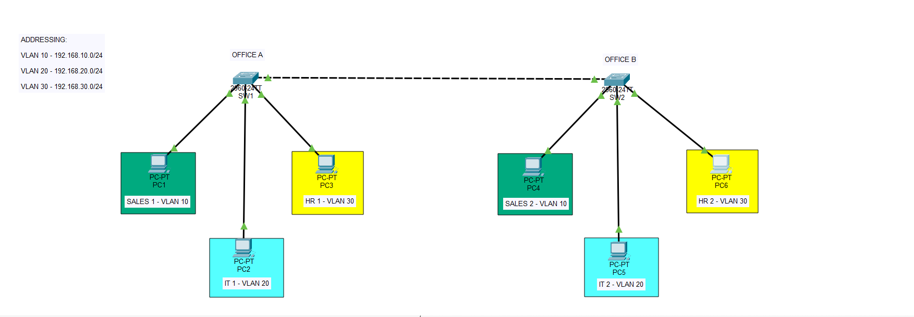
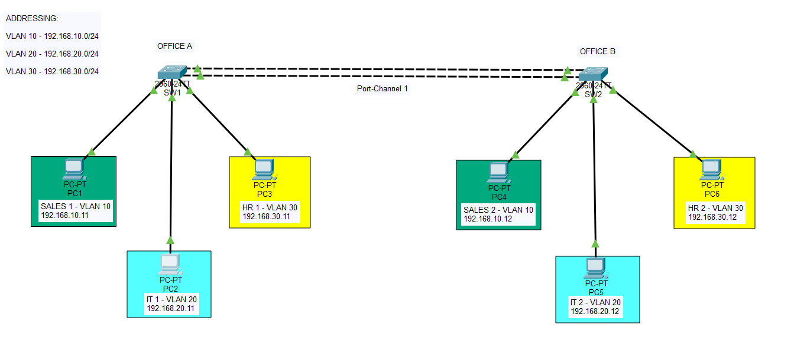

# Networking Labs

## About This Repository

The purpose of this repository is to document my
progress, apply networking concepts to business
scenarios, and improve my configuration and
troubleshooting skills.

## Tools and Technologies

- Cisco Packet Tracer
- Cisco IOS CLI
- Cisco Routers and Switches
- IPv4 Addressing and Subnetting
- Layer 2 and Layer 3 Networking

## Networking Lab Projects

| No. | Laboratory | Status |
| --- | --- | --- |
| 01 | [VLAN Configuration](./01-VLAN-Configuration/) | Completed |
| 02 | [EtherChannel](./02-EtherChannel/) | Completed |
| 03 | IPv4 Routing | Upcoming |
| 04 | Inter-VLAN Routing | Upcoming |
| 05 | Network Security | Upcoming |

---

## Lab 01 – VLAN Configuration

### Business Scenario

A small company has three departments: Sales,
Human Resources, and IT. Each department needs
to have its own network segment while maintaining
communication between devices belonging to the
same department across multiple switches.

VLANs and trunk links are used to meet these
requirements.

### Network Topology

### VLAN Assignment

| VLAN ID | Department | Network |
| --- | --- | --- |
| 10 | Sales | 192.168.10.0/24 |
| 20 | Human Resources | 192.168.20.0/24 |
| 30 | IT | 192.168.30.0/24 |

### Lab Objectives

- Configure and assign VLANs.
- Configure access and trunk ports.
- Implement IEEE 802.1Q trunking.
- Verify connectivity within the same VLAN.
- Verify network isolation between different VLANs.

[View Full Lab Documentation](./01-VLAN-Configuration/)

---
# Lab 02 - EtherChannel Configuration

## Overview

This lab is a continuation of the previous VLAN
configuration lab. The main purpose is to improve
the connection between the two switches by combining
multiple physical links into a single logical link
using EtherChannel.

LACP is used to provide additional bandwidth and
link redundancy between the two offices.

## Network Topology

## Business Requirements

- Increase the available bandwidth between switches.
- Provide redundancy in case one physical link fails.
- Combine two physical links into one logical link.
- Maintain trunk connectivity between the switches.
- Maintain the existing VLAN segmentation.

## VLAN Assignment

| VLAN ID | Department | Network |
|---------|------------|---------|
| 10 | Sales | 192.168.10.0/24 |
| 20 | IT | 192.168.20.0/24 |
| 30 | HR | 192.168.30.0/24 |

## Previous Lab

[View Full Lab Documentation](./02-EtherChannel/)

## Learning Resources

- Cisco Networking Academy (NetAcad)
- Cisco CCNA 200-301 Study Materials
- Independent Networking Practice

## About Me

**Vans Mcklyed S. Gonzales**

BS Information Technology Student

University of Cebu – Main Campus

This repository will be continuously updated as I
progress through my networking studies.
